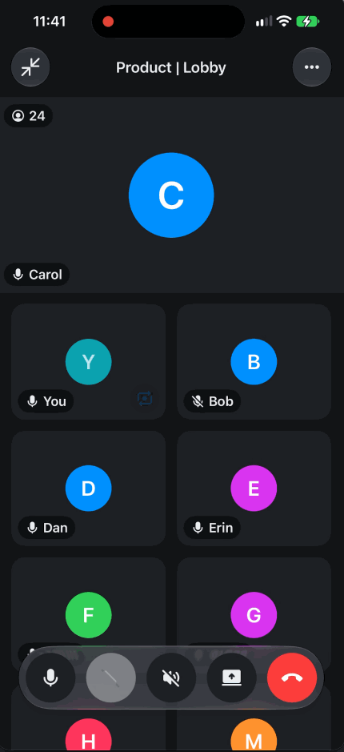

# Element Call for iOS

A native [MatrixRTC](https://github.com/matrix-org/matrix-spec-proposals/blob/main/proposals/4143-matrix-rtc.md)
call implementation for iOS: media, session, user interface and the Matrix side, built on
[matrix-rust-rtc](https://github.com/element-hq/matrix-rust-rtc).

<p align="center">
  
</p>

## A note on how this was built

This package was written with **substantial AI assistance**, and the same is true of most changes to it.
Every line has been read and reviewed by a person before landing, it is covered by the tests described
below, and it has been exercised in real calls on real devices. Pull requests here carry the same
disclosure checkbox that element-x-ios uses.

We mention it because it is worth knowing when you read the code. Some of the comments are longer than
you might expect: where a decision is not obvious from the code, the reason it was made is written
down next to it, including the ones that were got wrong first. [AGENTS.md](AGENTS.md) records the
constraints an agent working here must not break.

## Modules

| Module | Contents | Depends on |
| --- | --- | --- |
| `ElementCallKit` | Capture, render, packers, audio engine, key handling. | the RTC core |
| `ElementCallHost` | Call lifecycle, spotlight, Picture in Picture, and the ports. | nothing |
| `ElementCallUI` | Stage, tiles, controls, minimized bar. | design tokens |

No module knows the Matrix SDK exists, and SwiftLint enforces that: the host implements
`ElementCallMatrixBackendProtocol` over its own client, so a host's SDK bump never waits on a release
of this package.

**`ElementCall` itself is the umbrella**: a module containing nothing but `@_exported import` of the
three and of the core's bindings. A host that wants
the whole thing takes that one dependency and writes one `import ElementCall`, which is why the bare
name belongs to it rather than to a layer. The three remain published, so a host that only wants the
media layer can still depend on `ElementCallKit` alone.

`ElementCallHost` holds the ports a host implements and the lifecycle it drives; it is not the host's
own module, and a host that imports the umbrella never names it. It was called `ElementCall`, and the
umbrella was called `ElementCallAll`, until the two swapped — see [CHANGES.md](CHANGES.md).

## Integrating

Add it as a source dependency, pinned to an exact version:

```swift
.package(url: "https://github.com/element-hq/element-call-ios", exact: "0.1.0-rc.1")
```

```yaml
# Or, in an XcodeGen project.yml
packages:
  ElementCall:
    url: https://github.com/element-hq/element-call-ios
    exactVersion: 0.1.0-rc.1
```

Exactly, not a range: a renamed accessibility identifier is a breaking change, and at `0.x` the ports
are still moving. Releases are described in [RELEASING.md](RELEASING.md).

On the app target, take the umbrella product. It is the only product name involved:

```yaml
dependencies:
  - package: ElementCall
    product: ElementCall
```

Then give it a Matrix backend and a handful of small conformances, and you get a call.
[`Example/ElementCallExample/Matrix/SDKMatrixBackend.swift`](Example/ElementCallExample/Matrix/SDKMatrixBackend.swift)
is a backend over the Rust SDK's `Client`, unit-tested, to copy into your app.

```swift
let controller = ElementCallController(backend: SDKMatrixBackend(client: client, logger: logger)!,
                                       system: MyCallKitAdapter(),
                                       options: MyOptions(),
                                       style: ElementCallStyle(theme: MyTheme(),
                                                               icons: MyIcons(),
                                                               avatars: MyAvatars()),
                                       logger: logger)
```

Then start a call and present the screen:

```swift
controller.startCall(ElementCallData(isAudioCall: false, isStartingCall: true),
                     room: MyRoomContext(roomID: roomID))

ElementCallScreen(viewModel: ElementCallScreenViewModel(controller: controller))
```

There is nothing to start. When a call opens its room, the core subscribes through the backend to
what the room needs, and cancels those subscriptions when the call ends.

### What the host provides

| Port | What you supply | Turnkey? |
| --- | --- | --- |
| `ElementCallMatrixBackendProtocol` | every room send and feed, to-device, OpenID, RTC transports | copy `SDKMatrixBackend` from `Example/` |
| `ElementCallSystemProvidingProtocol` | CallKit, plus audio-session and mute events coming back | no |
| `ElementCallRoomContextProtocol` | room display name, direct flag, member profiles | no |
| `ElementCallAvatarRenderingProtocol` | avatar views, so they match your app | no |
| `ElementCallThemeProtocol`, `ElementCallIconRenderingProtocol` | colours, fonts and icons | defaults to the real Compound tokens |
| `ElementCallLoggingProtocol` | a log sink | defaults provided |
| `ElementCallOptions` | feature flags | **a value, not a protocol** — construct one, every member defaulted |

The ports that are not turnkey are the ones only a host can answer. CallKit is process-wide and usually
shared with something else. Room metadata and avatars come from whatever caching layer the host
already has, and what to call a room with no name is a product decision.

Two members of `ElementCallOptions` are worth setting before a first call. `isDeveloperModeEnabled`
reveals the per-tile diagnostics overlay, so point it at whatever already reveals developer surface
in your app rather than at the flag that enables calls. `isScreenSharingEnabled` is **off by
default**, because sharing needs work on the host side before it behaves; turn it on when you are
ready. Receiving someone else's share never depends on either. `isSFUFallbackEnabled`, also off,
lets a call whose own media server is down borrow another member's; turn it on only where those
servers accept users from other homeservers.

One call is worth making if your client can tell: `controller.reportConnectivity(isOnline:)`, with
`false` when your Matrix client goes offline and `true` once a request has succeeded again — not
when sync merely starts. It lets a call show "your server is unreachable" at once and retry its
sends the moment the server is back. Without it the call notices at its next send, which is fine.

Every port has a fake shipped alongside it, so previews and tests need no host at all.

### Theming, and why it is a port

Colours and fonts are **computed properties read at draw time**, never captured once. Element's design
system keeps its colours on a single shared instance that can be re-branded at runtime, so a snapshot
taken at construction would leave the call screen on stock colours while the rest of the app changed.

With no theme supplied, the package uses the real
[Compound design tokens](https://github.com/element-hq/compound-design-tokens), which is a small
package of static values with no such instance.

### Why it must be a source dependency

This said, for a while, that a prebuilt binary "would embed its own copy of the design system and
never see the override". That does not follow, and it is worth correcting rather than quietly deleting,
because it is the answer someone will reach for next time: the override travels through the
`ElementCallThemeProtocol` **port**, which is a protocol, and a protocol crosses a binary boundary perfectly
well. `CompoundDesignTokens` is static values, so a duplicated copy costs binary size, not colours.

The real reason is cost: a binary needs library evolution across every public declaration, and
nothing slow in a host's build would pay for it today.

[RELEASING.md](RELEASING.md#why-there-are-no-artifacts-on-the-release-page) has the rest, including the
one thing that would justify revisiting it.

### Two host build requirements

1. **Add `-ObjC` to your app target's other linker flags.** The RTC core links libwebrtc as a static
   archive, and its Objective-C categories are dead-stripped without the flag, so the app builds and
   then aborts at runtime with an unrecognised selector. Measured cost: 15.7 MiB on the linked
   binary, a 10.4% increase, essentially all of it libwebrtc's Objective-C surface. `-force_load` on
   the archive is not a smaller alternative, since it loads every object rather than only the
   Objective-C ones.
2. **Exclude the Intel simulator slice**, with `EXCLUDED_ARCHS[sdk=iphonesimulator*] = x86_64`. The
   media xcframework ships device and Apple Silicon simulator slices only, and a package cannot
   declare this for the projects that consume it.

## Development

```bash
brew install swiftformat swiftlint sourcery
swift build
```

Tests need a simulator, the `-ObjC` flag and a fixed locale. See
[CONTRIBUTING.md](CONTRIBUTING.md#tests).

## Copyright & License

Copyright (c) 2026 Element Creations Ltd.

This software is dual licensed by Element Creations Ltd (Element). It can be used either:

(1) for free under the terms of the GNU Affero General Public License (as published by the Free
Software Foundation, either version 3 of the License, or (at your option) any later version); OR

(2) under the terms of a paid-for Element Commercial License agreement between you and Element (the
terms of which may vary depending on what you and Element have agreed to).

Unless required by applicable law or agreed to in writing, software distributed under the Licenses is
distributed on an "AS IS" BASIS, WITHOUT WARRANTIES OR CONDITIONS OF ANY KIND, either express or
implied. See the Licenses for the specific language governing permissions and limitations under the
Licenses.
